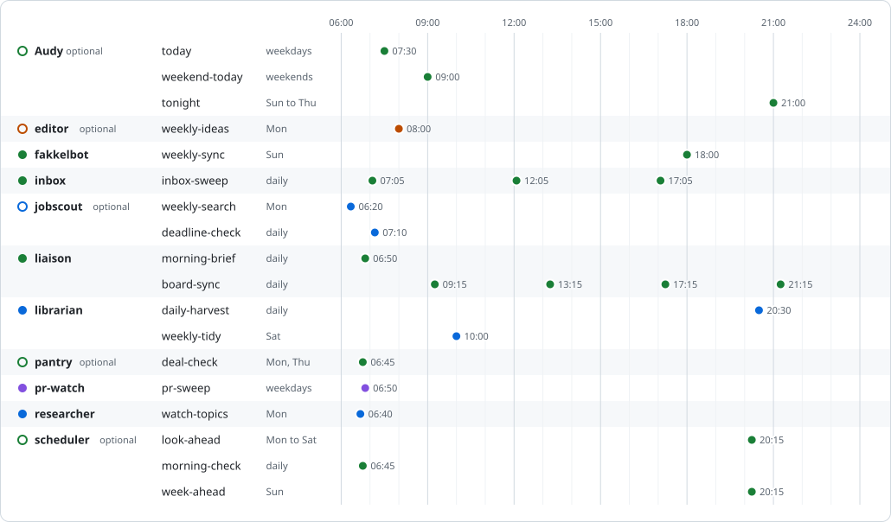

> Generated by `scripts/bot_chart.py` from `bots/*.md`. Don't edit this file by hand. After you change a bot file, run `python3 scripts/bot_chart.py`.

# Bot chart

Times are in the owner's timezone, like the schedules in the bot files. [scripts/README.md](../scripts/README.md#bot_chartpy) explains how the chart finds each arrow.

## Who talks to whom

### Hand-offs and what wakes each bot

Grey arrows are hand-offs between bots. The table of every edge below says where each one appears. Thick amber arrows are GitHub events that wake a bot. A bot's colour is its category: green for Daily life, blue for Work, purple for Builders and orange for Content. A pale bot with a dashed outline is one that fakkelbot adds only when the owner asks for it.

```mermaid
%%{init: {"flowchart": {"curve": "basis"}}}%%
flowchart TB
    bot_audy("Audy")
    bot_claude("claude")
    bot_clerk("clerk")
    bot_codex("codex")
    bot_cursor("cursor")
    bot_editor("editor")
    bot_fakkelbot("fakkelbot")
    bot_inbox("inbox")
    bot_jobscout("jobscout")
    bot_liaison("liaison")
    bot_librarian("librarian")
    bot_pantry("pantry")
    bot_pr_watch("pr-watch")
    bot_researcher("researcher")
    bot_scheduler("scheduler")
    fan_each_affected_bot(["each affected bot"])
    sys_github["GitHub"]
    bot_claude --> bot_liaison
    bot_claude --> bot_librarian
    bot_clerk --> bot_liaison
    bot_clerk --> bot_librarian
    bot_codex --> bot_liaison
    bot_codex --> bot_librarian
    bot_cursor --> bot_liaison
    bot_cursor --> bot_librarian
    bot_editor --> bot_liaison
    bot_editor --> bot_librarian
    bot_fakkelbot --> fan_each_affected_bot
    bot_fakkelbot --> bot_liaison
    bot_inbox --> bot_jobscout
    bot_inbox --> bot_liaison
    bot_inbox --> bot_librarian
    bot_inbox --> bot_scheduler
    bot_jobscout --> bot_liaison
    bot_jobscout --> bot_librarian
    bot_liaison --> fan_each_affected_bot
    bot_liaison --> bot_librarian
    bot_librarian --> bot_liaison
    bot_pantry --> bot_liaison
    bot_pantry --> bot_librarian
    bot_pr_watch --> bot_liaison
    bot_pr_watch --> bot_librarian
    bot_researcher --> bot_liaison
    bot_researcher --> bot_librarian
    bot_scheduler --> bot_liaison
    bot_scheduler --> bot_librarian
    sys_github ==>|"wakes: apply"| bot_fakkelbot
    classDef daily_life_optional fill:#1a7f3726,stroke:#1a7f37,stroke-width:2px,stroke-dasharray:5 3
    class bot_audy,bot_clerk,bot_pantry,bot_scheduler daily_life_optional
    classDef builders_optional fill:#8250df26,stroke:#8250df,stroke-width:2px,stroke-dasharray:5 3
    class bot_claude,bot_codex,bot_cursor builders_optional
    classDef content_optional fill:#bc4c0026,stroke:#bc4c00,stroke-width:2px,stroke-dasharray:5 3
    class bot_editor content_optional
    classDef daily_life fill:#1a7f37,stroke:#1a7f37,color:#ffffff
    class bot_fakkelbot,bot_inbox,bot_liaison daily_life
    classDef work_optional fill:#0969da26,stroke:#0969da,stroke-width:2px,stroke-dasharray:5 3
    class bot_jobscout work_optional
    classDef work fill:#0969da,stroke:#0969da,color:#ffffff
    class bot_librarian,bot_researcher work
    classDef builders fill:#8250df,stroke:#8250df,color:#ffffff
    class bot_pr_watch builders
    classDef system fill:transparent,stroke:#8c959f,stroke-width:1.5px
    class sys_github system
    classDef fan_out fill:transparent,stroke:#8c959f,stroke-dasharray:4 3
    class fan_each_affected_bot fan_out
    linkStyle 0,1,2,3,4,5,6,7,8,9,10,11,12,13,14,15,16,17,18,19,20,21,22,23,24,25,26,27,28 stroke:#8c959f,stroke-width:1.5px
    linkStyle 29 stroke:#d4a72c,stroke-width:3px
```

### What each bot uses

Each teal arrow points from a bot to a system it uses.

```mermaid
%%{init: {"flowchart": {"curve": "basis"}}}%%
flowchart TB
    bot_audy("Audy")
    bot_claude("claude")
    bot_codex("codex")
    bot_cursor("cursor")
    bot_editor("editor")
    bot_fakkelbot("fakkelbot")
    bot_inbox("inbox")
    bot_liaison("liaison")
    bot_librarian("librarian")
    bot_pr_watch("pr-watch")
    bot_researcher("researcher")
    bot_scheduler("scheduler")
    sys_github["GitHub"]
    sys_kb["knowledge base"]
    sys_board["agent board"]
    sys_gmail["Gmail"]
    sys_gcal["Google Calendar"]
    sys_claude_cli["Claude Code"]
    sys_cursor_cli["Cursor Agent"]
    sys_codex_cli["Codex CLI"]
    bot_audy --> sys_github
    bot_audy --> sys_kb
    bot_audy --> sys_board
    bot_claude --> sys_github
    bot_claude --> sys_board
    bot_claude --> sys_claude_cli
    bot_codex --> sys_github
    bot_codex --> sys_board
    bot_codex --> sys_codex_cli
    bot_cursor --> sys_github
    bot_cursor --> sys_board
    bot_cursor --> sys_cursor_cli
    bot_editor --> sys_github
    bot_editor --> sys_kb
    bot_fakkelbot --> sys_github
    bot_inbox --> sys_gmail
    bot_liaison --> sys_board
    bot_librarian --> sys_github
    bot_librarian --> sys_kb
    bot_librarian --> sys_board
    bot_pr_watch --> sys_github
    bot_researcher --> sys_kb
    bot_scheduler --> sys_gcal
    classDef daily_life_optional fill:#1a7f3726,stroke:#1a7f37,stroke-width:2px,stroke-dasharray:5 3
    class bot_audy,bot_scheduler daily_life_optional
    classDef builders_optional fill:#8250df26,stroke:#8250df,stroke-width:2px,stroke-dasharray:5 3
    class bot_claude,bot_codex,bot_cursor builders_optional
    classDef content_optional fill:#bc4c0026,stroke:#bc4c00,stroke-width:2px,stroke-dasharray:5 3
    class bot_editor content_optional
    classDef daily_life fill:#1a7f37,stroke:#1a7f37,color:#ffffff
    class bot_fakkelbot,bot_inbox,bot_liaison daily_life
    classDef work fill:#0969da,stroke:#0969da,color:#ffffff
    class bot_librarian,bot_researcher work
    classDef builders fill:#8250df,stroke:#8250df,color:#ffffff
    class bot_pr_watch builders
    classDef system fill:transparent,stroke:#8c959f,stroke-width:1.5px
    class sys_github,sys_kb,sys_board,sys_gmail,sys_gcal,sys_claude_cli,sys_cursor_cli,sys_codex_cli system
    linkStyle 0,1,2,3,4,5,6,7,8,9,10,11,12,13,14,15,16,17,18,19,20,21,22 stroke:#3192aa,stroke-width:1.5px
```

### Every edge

| From | To | Kind | Where |
|---|---|---|---|
| claude | liaison | hands off to | instructions |
| claude | librarian | hands off to | instructions |
| clerk | liaison | hands off to | instructions |
| clerk | librarian | hands off to | instructions |
| codex | liaison | hands off to | instructions |
| codex | librarian | hands off to | instructions |
| cursor | liaison | hands off to | instructions |
| cursor | librarian | hands off to | instructions |
| editor | liaison | hands off to | instructions |
| editor | librarian | hands off to | instructions |
| fakkelbot | each affected bot | hands off to | instructions |
| fakkelbot | liaison | hands off to | instructions |
| inbox | jobscout | hands off to | instructions, inbox-sweep |
| inbox | liaison | hands off to | instructions |
| inbox | librarian | hands off to | instructions |
| inbox | scheduler | hands off to | instructions, inbox-sweep |
| jobscout | liaison | hands off to | instructions |
| jobscout | librarian | hands off to | instructions |
| liaison | each affected bot | hands off to | board-sync |
| liaison | librarian | hands off to | instructions |
| librarian | liaison | hands off to | instructions |
| pantry | liaison | hands off to | instructions |
| pantry | librarian | hands off to | instructions |
| pr-watch | liaison | hands off to | instructions |
| pr-watch | librarian | hands off to | instructions |
| researcher | liaison | hands off to | instructions |
| researcher | librarian | hands off to | instructions, watch-topics |
| scheduler | liaison | hands off to | instructions |
| scheduler | librarian | hands off to | instructions |
| GitHub | fakkelbot | wakes | apply |
| Audy | GitHub | uses | instructions |
| Audy | knowledge base | uses | instructions |
| Audy | agent board | uses | instructions |
| claude | GitHub | uses | instructions |
| claude | agent board | uses | instructions |
| claude | Claude Code | uses | instructions |
| codex | GitHub | uses | instructions |
| codex | agent board | uses | instructions |
| codex | Codex CLI | uses | instructions |
| cursor | GitHub | uses | instructions |
| cursor | agent board | uses | instructions |
| cursor | Cursor Agent | uses | instructions |
| editor | GitHub | uses | weekly-ideas |
| editor | knowledge base | uses | instructions |
| fakkelbot | GitHub | uses | instructions, apply, weekly-sync |
| inbox | Gmail | uses | instructions, inbox-sweep |
| liaison | agent board | uses | instructions, board-sync |
| librarian | GitHub | uses | daily-harvest |
| librarian | knowledge base | uses | instructions, daily-harvest, weekly-tidy |
| librarian | agent board | uses | instructions, daily-harvest |
| pr-watch | GitHub | uses | instructions, pr-sweep |
| researcher | knowledge base | uses | instructions |
| scheduler | Google Calendar | uses | instructions |

## A day of scheduled routines

<picture>
  <source media="(prefers-color-scheme: dark)" srcset="bot-chart-schedule-dark.svg">
  
</picture>

Each dot is a routine's start time. A filled dot on the left marks a bot that fakkelbot adds by default, and a ring marks an optional one.

Routines that only run on GitHub events are in the tables below.

## Routines by bot

### Audy (optional)

No routines.

### claude (optional)

No routines.

### clerk (optional)

No routines.

### codex (optional)

No routines.

### cursor (optional)

No routines.

### editor (optional)

| Routine | Schedule | Trigger | Enabled |
|---|---|---|---|
| weekly-ideas | Mondays at 08:00 | none | yes |

### fakkelbot

| Routine | Schedule | Trigger | Enabled |
|---|---|---|---|
| apply | none | pr-merged in grok-bot-setup | yes |
| weekly-sync | Sundays at 18:00 | none | yes |

### inbox

| Routine | Schedule | Trigger | Enabled |
|---|---|---|---|
| inbox-sweep | daily at 07:05, 12:05, 17:05 | none | yes |

### jobscout (optional)

| Routine | Schedule | Trigger | Enabled |
|---|---|---|---|
| weekly-search | Mondays at 06:20 | none | yes |
| deadline-check | daily at 07:10 | none | yes |

### liaison

| Routine | Schedule | Trigger | Enabled |
|---|---|---|---|
| morning-brief | daily at 07:30 | none | yes |
| board-sync | daily at 09:15, 13:15, 17:15, 21:15 | none | yes |

### librarian

| Routine | Schedule | Trigger | Enabled |
|---|---|---|---|
| daily-harvest | daily at 20:30 | none | yes |
| weekly-tidy | Saturdays at 10:00 | none | yes |

### pantry (optional)

| Routine | Schedule | Trigger | Enabled |
|---|---|---|---|
| deal-check | Mon and Thu at 06:45 | none | yes |

### pr-watch

| Routine | Schedule | Trigger | Enabled |
|---|---|---|---|
| pr-sweep | weekdays at 06:50 | none | yes |

### researcher

| Routine | Schedule | Trigger | Enabled |
|---|---|---|---|
| watch-topics | Mondays at 06:40 | none | yes |

### scheduler (optional)

| Routine | Schedule | Trigger | Enabled |
|---|---|---|---|
| look-ahead | Mon to Sat at 21:00 | none | yes |
| morning-check | daily at 07:00 | none | yes |
| week-ahead | Sundays at 21:00 | none | yes |
