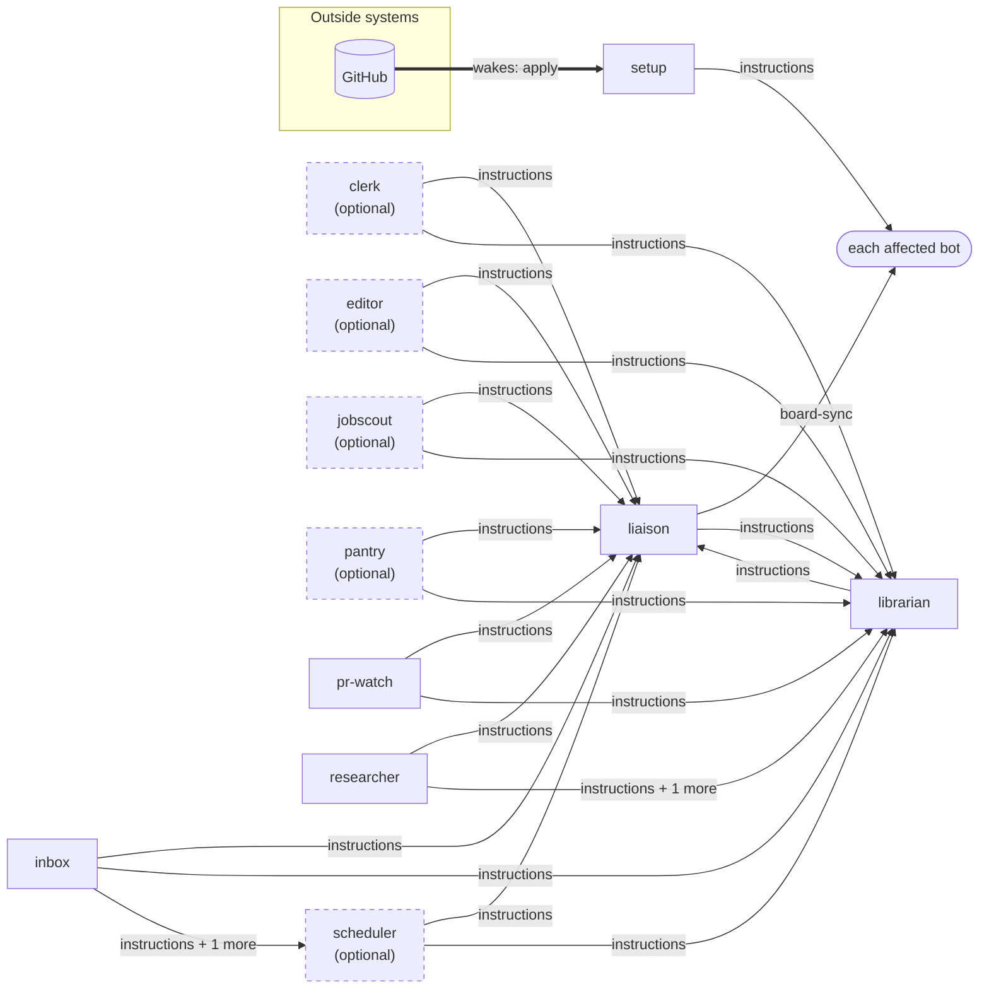
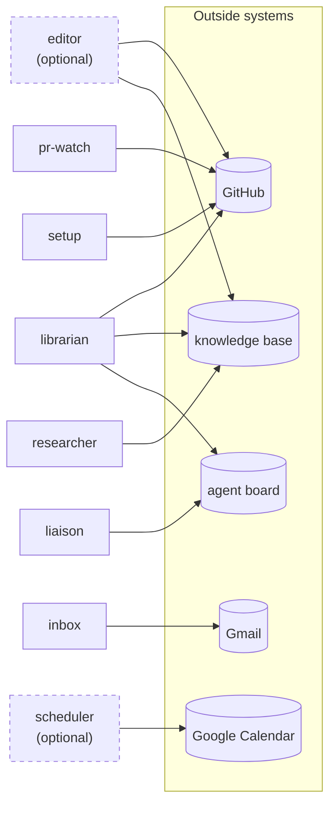

> Generated by `scripts/bot_chart.py` from `bots/*.md`. Don't edit this file by hand. After you change a bot file, run `python3 scripts/bot_chart.py`.

# Bot chart

Times are in the owner's timezone, like the schedules in the bot files. [scripts/README.md](../scripts/README.md#bot_chartpy) explains how the chart finds each arrow.

## Who talks to whom

### Hand-offs and what wakes each bot

Solid arrows are hand-offs between bots. Thick arrows are GitHub events that wake a bot. A dashed border marks a bot that setup adds only when the owner asks for it.

### What each bot uses

Each arrow points from a bot to a system it uses.

### Every edge

| From | To | Kind | Where |
|---|---|---|---|
| clerk | liaison | hands off to | instructions |
| clerk | librarian | hands off to | instructions |
| editor | liaison | hands off to | instructions |
| editor | librarian | hands off to | instructions |
| inbox | liaison | hands off to | instructions |
| inbox | librarian | hands off to | instructions |
| inbox | scheduler | hands off to | instructions, inbox-sweep |
| jobscout | liaison | hands off to | instructions |
| jobscout | librarian | hands off to | instructions |
| liaison | each affected bot | hands off to | board-sync |
| liaison | librarian | hands off to | instructions |
| librarian | liaison | hands off to | instructions |
| pantry | liaison | hands off to | instructions |
| pantry | librarian | hands off to | instructions |
| pr-watch | liaison | hands off to | instructions |
| pr-watch | librarian | hands off to | instructions |
| researcher | liaison | hands off to | instructions |
| researcher | librarian | hands off to | instructions, watch-topics |
| scheduler | liaison | hands off to | instructions |
| scheduler | librarian | hands off to | instructions |
| setup | each affected bot | hands off to | instructions |
| GitHub | setup | wakes | apply |
| editor | GitHub | uses | weekly-ideas |
| editor | knowledge base | uses | instructions |
| inbox | Gmail | uses | instructions, inbox-sweep |
| liaison | agent board | uses | instructions, board-sync |
| librarian | GitHub | uses | daily-harvest |
| librarian | knowledge base | uses | instructions, daily-harvest, weekly-tidy |
| librarian | agent board | uses | instructions, daily-harvest |
| pr-watch | GitHub | uses | instructions, pr-sweep |
| researcher | knowledge base | uses | instructions |
| scheduler | Google Calendar | uses | instructions |
| setup | GitHub | uses | instructions, apply, weekly-sync |

## A day of scheduled routines

```mermaid
gantt
    dateFormat HH:mm
    axisFormat %H:%M
    tickInterval 1hour
    todayMarker off
    section editor (optional)
    weekly-ideas (Mon) :08:00, 15m
    section inbox
    inbox-sweep (daily) :07:05, 15m
    inbox-sweep (daily) :12:05, 15m
    inbox-sweep (daily) :17:05, 15m
    section jobscout (optional)
    weekly-search (Mon) :06:20, 15m
    deadline-check (daily) :07:10, 15m
    section liaison
    morning-brief (daily) :07:30, 15m
    board-sync (daily) :09:15, 15m
    board-sync (daily) :13:15, 15m
    board-sync (daily) :17:15, 15m
    board-sync (daily) :21:15, 15m
    section librarian
    weekly-tidy (Sat) :10:00, 15m
    daily-harvest (daily) :20:30, 15m
    section pantry (optional)
    deal-check (Mon, Thu) :06:45, 15m
    section pr-watch
    pr-sweep (weekdays) :06:50, 15m
    section researcher
    watch-topics (Mon) :06:40, 15m
    section scheduler (optional)
    morning-check (daily) :07:00, 15m
    look-ahead (Mon to Sat) :21:00, 15m
    week-ahead (Sun) :21:00, 15m
    section setup
    weekly-sync (Sun) :18:00, 15m
```

Bars mark start times, not run length.

Routines that only run on GitHub events are in the tables below.

## Routines by bot

### clerk (optional)

No routines.

### editor (optional)

| Routine | Schedule | Trigger | Enabled |
|---|---|---|---|
| weekly-ideas | Mondays at 08:00 | none | yes |

### inbox

| Routine | Schedule | Trigger | Enabled |
|---|---|---|---|
| inbox-sweep | daily at 07:05, 12:05, 17:05 | none | yes |

### jobscout (optional)

| Routine | Schedule | Trigger | Enabled |
|---|---|---|---|
| weekly-search | Mondays at 06:20 | none | yes |
| deadline-check | daily at 07:10 | none | yes |

### liaison

| Routine | Schedule | Trigger | Enabled |
|---|---|---|---|
| morning-brief | daily at 07:30 | none | yes |
| board-sync | daily at 09:15, 13:15, 17:15, 21:15 | none | yes |

### librarian

| Routine | Schedule | Trigger | Enabled |
|---|---|---|---|
| daily-harvest | daily at 20:30 | none | yes |
| weekly-tidy | Saturdays at 10:00 | none | yes |

### pantry (optional)

| Routine | Schedule | Trigger | Enabled |
|---|---|---|---|
| deal-check | Mon and Thu at 06:45 | none | yes |

### pr-watch

| Routine | Schedule | Trigger | Enabled |
|---|---|---|---|
| pr-sweep | weekdays at 06:50 | none | yes |

### researcher

| Routine | Schedule | Trigger | Enabled |
|---|---|---|---|
| watch-topics | Mondays at 06:40 | none | yes |

### scheduler (optional)

| Routine | Schedule | Trigger | Enabled |
|---|---|---|---|
| look-ahead | Mon to Sat at 21:00 | none | yes |
| morning-check | daily at 07:00 | none | yes |
| week-ahead | Sundays at 21:00 | none | yes |

### setup

| Routine | Schedule | Trigger | Enabled |
|---|---|---|---|
| apply | none | pr-merged in grok-bot-setup | yes |
| weekly-sync | Sundays at 18:00 | none | yes |
